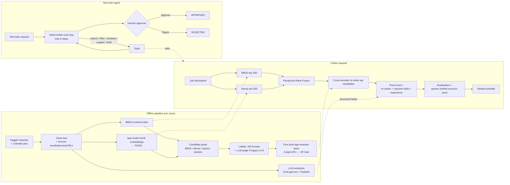
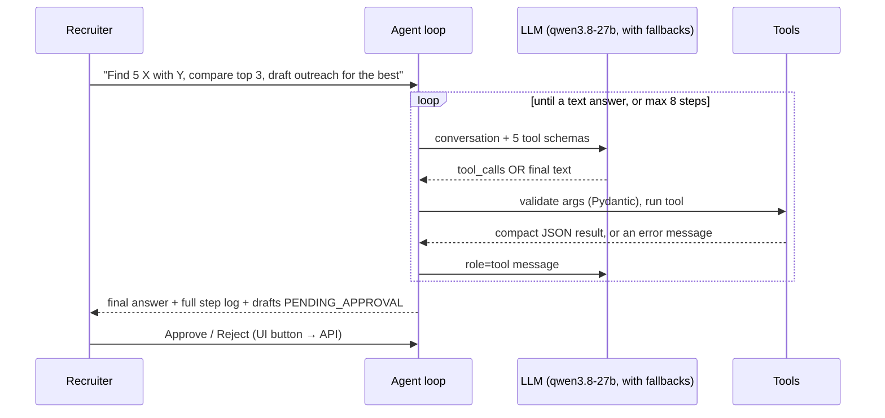

# TalentLens

**Explainable AI job matching with a recruiter agent.**

TalentLens takes a job description and returns a ranked shortlist of candidates. For every candidate it shows *why*: which required skills they have and lack, whether their experience fits, and short quotes copied word-for-word from their resume as evidence (each quote is checked by code, and any quote not found in the resume is dropped). A recruiter agent sits on top. You can ask it *"find 5 accountants who know QuickBooks, compare the top 3 and draft outreach for the best one"*, and it does the searching, filtering and comparing with tools. It never sends anything: every outreach draft waits for a human to click **Approve**.

Every number in this README is produced by a script and saved under [`results/`](results/). Nothing is typed in by hand. Where a result does not exist yet, the table says so.

**Live demo:** https://talent-lens-khaki.vercel.app. The backend runs on demand (see [section 9](#9-deployment)), so ask for a fresh link if the page says the backend is offline.

**In one minute:**

| | |
|---|---|
| **Input** | A job description (or a resume, for the reverse direction), or a recruiter request in plain English |
| **Output** | Ranked candidates, each with a score breakdown, matched and missing skills, experience fit and word-for-word evidence quotes |
| **Data** | 2,481 public Kaggle resumes (24 occupations) and 3,000 LinkedIn job postings, with contact details removed |
| **Pipeline** | BM25 + dense embeddings → Reciprocal Rank Fusion → cross-encoder re-ranker → requirement checks → verified explanations |
| **Agent** | A hand-written tool-calling loop (5 tools, max 8 steps); outreach drafts wait for human approval |
| **Checks** | Retrieval metrics (Recall@100, nDCG@10, MRR), LLM-judge agreement (Cohen's κ), extraction P/R/F1, counterfactual fairness and a 20-task agent evaluation; 143 tests run in CI |
| **Cost** | Runs entirely on free tiers: Groq's free LLM API, CPU models, Vercel, a Cloudflare tunnel and free Colab for fine-tuning |

---

## Status

| Stage | Code | Tests | Real results | What is still needed |
|---|---|---|---|---|
| 1. Data loading & cleaning | ✅ | ✅ | ✅ [`data_stats.json`](results/data_stats.json) | – |
| 2. Extraction (LLM + rule-based) | ✅ | ✅ | 🟡 rules: all 2,481 resumes; LLM: gold set (120b 100/100) | 100 hand labels for accuracy |
| 3. Ground truth (splits, pools, judge) | ✅ | ✅ | 🟡 splits + 3,010 pooled pairs ([`splits.json`](results/splits.json)) | 200 hand labels, then the judge |
| 4. Hybrid retrieval + evaluation | ✅ | ✅ | 🟡 indexes built ([`index_build.json`](results/index_build.json)) | labels (Stage 3) for metrics |
| 5. Cross-encoder re-ranker | ✅ (+ Colab notebook) | ✅ (notebook smoke-tested) | ⬜ | judge labels → export → Colab → HF Hub |
| 6. Explainable matches | ✅ | ✅ | 🟡 quote verification works live | labels for weight tuning; quote-failure run |
| 7. Recruiter agent | ✅ | ✅ | 🟡 1 of 20 tasks run (smoke test, passed); 3 demo tasks work | full 20-task run (spread over free-tier days) |
| 8. Fairness check | ✅ | ✅ | ✅ [`fairness_report.md`](results/fairness_report.md) | re-run with the fine-tuned re-ranker |
| 9. API + frontend + tests | ✅ | ✅ 143 tests | ✅ live demo ([`docs/DEMO.md`](docs/DEMO.md)) | screenshots |
| 10. Docker, CI, deploy | ✅ | CI + Docker image tested locally | ✅ frontend on Vercel; backend through a Cloudflare tunnel ([docs/DEPLOY.md](docs/DEPLOY.md)) | always-on backend (paid option ready) |

---

## Table of contents

1. [The problem](#1-the-problem)
2. [What TalentLens does](#2-what-talentlens-does)
3. [Architecture](#3-architecture)
4. [How it works, step by step](#4-how-it-works-step-by-step)
5. [How the metrics work](#5-how-the-metrics-work)
6. [Results](#6-results)
   - [Example output](#example-output)
   - [Demo](#demo)
7. [API](#7-api)
8. [Running it](#8-running-it)
9. [Deployment](#9-deployment)
10. [Repository layout](#10-repository-layout)
11. [Limitations](#11-limitations)
12. [Scaling to 10 million candidates](#12-scaling-to-10-million-candidates)
13. [Data licences and ethics](#13-data-licences-and-ethics)
14. [Glossary](#14-glossary)
15. [Configuration reference](#15-configuration-reference)
16. [Design decisions](#16-design-decisions)
17. [Troubleshooting](#17-troubleshooting)

---

## 1. The problem

Recruiters get hundreds of applications per role. Keyword filters in applicant tracking systems miss good candidates who describe the same skill differently ("Postgres" vs "PostgreSQL", "built REST services" vs "backend development"). Pure AI scoring creates the opposite problem: a single number with no reason behind it, which a recruiter can't trust or check, and which may hide bias.

A useful matching system needs to be:

- **Accurate:** good candidates near the top.
- **Fast:** results in well under a second, even over a large pool.
- **Explainable:** every score comes with checkable reasons.
- **Fair:** changing a candidate's name shouldn't change their rank.
- **Measured:** each of the above is a number, not a claim.

---

## 2. What TalentLens does

| Feature | What it means for a recruiter | How it's measured |
|---|---|---|
| Structured extraction | Messy resumes and job posts become clean fields: skills, years, seniority, location | Field-level precision / recall / F1 against 100 hand-labelled resumes |
| Two-stage matching | Fast broad search, then a precise re-ranker over the top 100 | Recall@100, nDCG@10, MRR, latency |
| Explanations | Matched/missing skills, experience fit, evidence quotes | % of LLM quotes that fail word-for-word verification |
| Recruiter agent | Natural-language requests become tool calls; outreach waits for approval | Task success rate, average steps, average cost on 20 scripted tasks |
| Fairness check | Tests whether names or gender-coded words move rankings | Average rank shift, % of top-10 lists changed, score difference, before/after mitigation |
| Reverse matching | Paste a resume, get the best-fit jobs | Same pipeline, reverse direction |

---

## 3. Architecture



**Stack:** Python, pandas, rank_bm25 (+ a numpy inverted index), sentence-transformers, FAISS, transformers (BAAI/bge-reranker-base), Groq API, Pydantic, FastAPI, Next.js 15 / React 19, pytest, Docker, GitHub Actions, Vercel, Cloudflare Tunnel, Hugging Face Hub, Google Colab.

**LLMs (all on Groq's free tier):**

| Job | Model | Fallbacks |
|---|---|---|
| Bulk extraction | `openai/gpt-oss-20b` | – |
| Gold-set extraction, LLM judge | `openai/gpt-oss-120b` | – |
| Recruiter agent | `qwen/qwen3.8-27b` | `gpt-oss-120b`, then `gpt-oss-20b` (same conversation continues) |
| Evidence quotes | `openai/gpt-oss-20b` | `gpt-oss-120b`, `qwen3.8-27b`; without any LLM, matching still works and says quotes are unavailable |

Each model has its own daily quota on the free tier (about 200k tokens per day), so spreading jobs across models keeps the demo working. Llama 3.3 was retired from Groq before this project started.

**Serving path in one request** (`POST /match/job`):
1. Read the job's requirements: LLM extraction, merged with rule-based parsing and cleaned of generic words like "communication".
2. Retrieve the top 100 with BM25 and dense search, fused by RRF.
3. Re-rank the top 30 with the cross-encoder.
4. Compute the final score from the re-ranker, skill coverage and experience fit.
5. Ask the LLM for evidence quotes for the top 3, and keep only the quotes code finds in the resume.
6. Cache the result: an in-memory LRU and a disk cache keyed by a logic version, so a code change invalidates old answers. Incomplete results (for example, quotes missing because of quota) are never cached.

---

## 4. How it works, step by step

### 4.1 Data and privacy (Stage 1)

**Sources:** Kaggle "Resume Dataset" (2,484 resumes, 24 categories) and Kaggle "LinkedIn Job Postings" (123,849 postings).

| Step | Why |
|---|---|
| Strip HTML, decode entities (`&` → `&`), fix mojibake (`’` → `'`) with ftfy | Garbage tokens hurt BM25, embeddings and quote verification |
| Unicode NFKC, remove zero-width/control chars, collapse whitespace | Comparable lengths; quotes match reliably |
| Replace emails, phone numbers and profile URLs with `[EMAIL]`, `[PHONE]`, `[URL]` | Resumes are personal data. Contact details aren't needed for matching and must not reach an external LLM API or GitHub. Phone patterns are deliberately narrow so date ranges like `2010 - 2014` survive (tested) |
| Stable IDs from the dataset's own IDs (`R16852973`, `J3884428798`) | Labels, caches and splits keep pointing at the same document on every re-run |
| Map job titles to the 24 resume categories (ordered keyword rules, first match wins) and sample evenly with a fixed seed | Most jobs have plausible candidates; no category dominates; same 3,000 jobs every run |
| Drop duplicate texts and very short rows | LinkedIn reposts the same ad; a duplicate could land in train and test (leakage) |
| Save as Parquet | Typed, compressed, keeps long text intact |

A finding from the data: 93% of resumes contain the placeholder `City , State`, because the dataset anonymised locations. Location filtering therefore can't work on this data, and the agent says so.

### 4.2 Structured extraction with an LLM (Stage 2)

**Resume schema:** `skills`, `total_years_experience`, `job_titles`, `education_level`, `location`, `seniority`.
**Job schema:** `title`, `required_skills`, `nice_to_have_skills`, `min_years_experience`, `location`, `seniority`.

- **Pydantic validation** with `extra="forbid"` and enum fields. Wrong types, missing fields or values like `seniority: "kinda senior"` are rejected.
- **Repair loop:** the exact validation error is sent back to the LLM ("seniority: Input should be 'intern', 'entry', …"), up to 2 times. Groq's JSON mode can also reject malformed JSON server-side (HTTP 400 `json_validate_failed`); that goes through the same repair loop.
- **Skill normalisation** via [`configs/skill_aliases.yaml`](configs/skill_aliases.yaml) (`JS` → `JavaScript`, `postgres` → `PostgreSQL`, `MS Excel` → `Microsoft Excel`).
- **Cache:** every call is stored under a SHA-256 of *(model, messages, settings)*; the prompt version is part of the messages, so changing the prompt automatically misses the cache. Re-runs are free.
- **Rate limits:** a 60-second sliding window per model (requests and tokens). HTTP 429 is retried after `retry-after`. If the provider asks to wait longer than 2 minutes (the daily quota), the run stops cleanly, saves what it has, and **merges** with earlier results next time; answers already cached are still collected after the quota runs out.
- **Request-size guard:** Groq counts *input + max output tokens* against the per-minute limit and refuses (HTTP 413) a single request bigger than that. For unusually long inputs the client lowers the output cap so the request fits.
- **Cost log:** every call (cache hits at cost 0) goes to `results/llm_costs.csv`. Token counts are exact; prices in config are marked unverified.

**Accuracy** is measured against 100 resumes you label yourself ([`scripts/02b_label_extraction.py`](scripts/02b_label_extraction.py)), spread across all 24 categories:
- List fields (skills, job titles): micro precision / recall / F1, strict case-insensitive match after normalisation.
- Scalar fields: precision = correct / predicted, recall = correct / labelled, plus accuracy. Years count as correct within ±1.
- **Blind** labelling (you type every field) is the default. **Assisted** mode (start from the model's answer) is faster but pulls labels toward the model; every label records which mode was used, and the report shows it.

### 4.3 Ground truth: splits, pools, human labels, LLM judge (Stage 3)

**Split by job first.** All 3,000 jobs are split 70/15/15 into train/validation/test, stratified by category, **by job**: every pair for a job lands in that job's split.

> *Why it matters:* if a job appeared in both train and test, the re-ranker could memorise that job's wording and its good candidates during training and "recognise" them at test time. That inflates scores without the model learning anything general (data leakage). Splitting by job tests what a real system must do: rank candidates for a job it has never seen. The script asserts that no job is in two splits.

**Pooling.** For 300 jobs, 10 candidates each come from four sources: BM25 top-20 (3), dense top-20 (3), the *middle* of the hybrid list, ranks 21–100 (2, the borderline cases), and random resumes (2). Drawing candidates from one method would bias the labels toward that method; this is the TREC pooling idea.

**Human labels: 200 pairs** (50 test jobs × 4, one from each source) with a 0/1/2 rubric. The pairs come in shuffled order and you never see which method found the candidate. Your jobs come from the **test** split, so they also form a trusted test set.

| Label | Meaning |
|---|---|
| 0 | No fit: different occupation, or missing most core requirements |
| 1 | Partial fit: related background, clear gaps |
| 2 | Strong fit: same occupation, meets most core requirements |

**LLM judge.** The judge sees the **exact same rubric text** ([`rubric.py`](src/talentlens/labeling/rubric.py)) and writes a one-sentence reason before the label. Agreement with your 200 labels:
- **Cohen's κ** = (p_observed − p_chance) / (1 − p_chance): agreement beyond chance.
- **Quadratic weighted κ**: a 0-vs-2 disagreement costs more than 0-vs-1 (the labels are ordered).
- **3×3 confusion matrix:** *where* the judge disagrees (e.g. too generous with 2).

The judge labels the other ~3,000 pairs **only if weighted κ ≥ 0.6** ("substantial" on the Landis & Koch scale). The script refuses otherwise.

**Circularity guard:** the re-ranker is trained on judge labels, so test metrics are always reported twice: on judge labels (large) and on **your** labels only (small, trusted).

### 4.4 Stage one: hybrid retrieval (Stage 4)

**BM25 (lexical).** Scores word overlap, weighting rare words (IDF), with diminishing returns for repeats (`k1`) and length normalisation (`b`). `rank_bm25` builds the statistics; scoring uses an **inverted index** (term → documents containing it) with numpy, which gives identical scores (tested) in ~6 ms instead of seconds for a 500-word job post. That's the same structure Elasticsearch uses.
- *Wins:* exact skills and acronyms ("QuickBooks", "AutoCAD", "FAA").
- *Fails:* synonyms and paraphrase.

**Dense (semantic).** `BAAI/bge-small-en-v1.5` (384-dim) embeds text; FAISS finds nearest vectors by cosine similarity. Resumes average ~800 words but the model reads at most 512 tokens (~380 words), so each resume is split into **overlapping 300-word chunks** (8,773 chunks for 2,481 resumes) and a resume's score is its **best chunk's** score (max-pooling).
- *Wins:* meaning ("client relationship management" ≈ "account management").
- *Fails:* rare exact terms; nuance lost by compressing a passage into one vector.

**Hybrid with Reciprocal Rank Fusion.** BM25 scores (0–50+) and cosines (0–1) are on different scales, so adding them is meaningless. RRF uses ranks only:

```
RRF(doc) = Σ over methods  1 / (k + rank_method(doc))
```

| Resume | BM25 rank | Dense rank | RRF (k = 60) |
|---|---|---|---|
| A | 1 | 10 | 1/61 + 1/70 = 0.03068 |
| B | 3 | 3 | 1/63 + 1/63 = 0.03175 |

B wins: being found by **both** methods beats being first in one. **k** controls how much the top positions dominate. With k = 0, rank 1 (1.0) beats two third places (0.67); with k = 60, ranks 1 and 5 are worth almost the same, so agreement matters more. Both cases are unit-tested. `--sweep-k` tunes k on **validation**, never test.

**Evaluation:** [`scripts/04b_evaluate.py`](scripts/04b_evaluate.py) computes Recall@100, nDCG@10, MRR and latency per method on the **test** split, and writes 3 real example queries where BM25 and dense disagree most.

### 4.5 Stage two: cross-encoder re-ranking (Stage 5)

| | Bi-encoder (stage one) | Cross-encoder (stage two) |
|---|---|---|
| Input | Job and resume encoded **separately** | Job and resume **together** in one input |
| Speed | Resume vectors precomputed; search in ms | One model run per pair |
| Accuracy | Lower: the texts never "see" each other | Higher: attention compares every job word with every resume word |
| Used for | The whole pool | Re-ordering the top candidates |

The cross-encoder reads 512 tokens for job + resume together; [`pair_texts`](src/talentlens/rerank/cross_encoder.py) builds that input (job title + first 150 words; first 350 words of the resume), and the **same function** builds the training data.

**Fine-tuning** ([`notebooks/finetune_reranker.ipynb`](notebooks/finetune_reranker.ipynb), free Colab T4):
- **Data:** judge-labelled TRAIN pairs. Your labels are all in test and are never trained on.
- **Loss:** binary cross-entropy with soft targets (0 → 0.0, 1 → 0.5, 2 → 1.0). It keeps the "partial" signal, and it's stable on a small dataset. Listwise LambdaLoss is a future experiment.
- **Hard negatives:** already in the pools. Pairs found by BM25/dense top-20 that were labelled 0 look relevant but aren't, which teaches fine distinctions. Unlabelled resumes are *not* used as negatives (some are real matches nobody labelled).
- **LR 2e-5, 10% warm-up, ≤ 4 epochs, early stopping (patience 1) on validation nDCG@10.** The best checkpoint is kept. If fine-tuning never beats the base model on validation, the notebook says so and nothing is pushed.
- **Leakage check** inside the notebook: it asserts no job is in both train and validation.

**Ablation** ([`scripts/05b_eval_rerankers.py`](scripts/05b_eval_rerankers.py)): BM25 → dense → hybrid → hybrid + bge-reranker-base → hybrid + fine-tuned, with nDCG@10, MRR, latency.

### 4.6 Explainable matches (Stage 6)

For each (job, candidate):
- **Required skills matched/missing**, **nice-to-have matched**, computed in code. A skill counts as matched if it's in the extracted skills **or** any known spelling appears in the resume text. Ambiguous short aliases ("go", "word", "ar") are excluded from text search to avoid false matches.
- **Experience fit:** "has 6 years, needs 3+" (1.0 if met, years/minimum if below, 0.5 if unknown).
- **Seniority and location fit.**
- **2–3 evidence quotes** from the LLM, **each verified in code**: after normalising whitespace, quote marks and dashes, the quote must be an **exact, case-sensitive substring** of the resume and at least 15 characters. Failures are dropped and counted. In a live test the verifier caught one invented quote out of nine.

**Final score:**
```
final = w_r · sigmoid(re-ranker logit) + w_s · required-skill coverage + w_e · experience fit
```
The re-ranker captures overall relevance but sees only ~500 tokens and has no notion of "mandatory". Coverage and experience are the checks a recruiter does, and each part is shown in the UI. If a part is unavailable (no required skills listed), its weight is spread over the rest. Weights are grid-searched on **validation** (`--tune`) and saved to `results/score_weights.json`. Without a re-ranker (small server), the retrieval rank supplies the relevance part.

### 4.7 The recruiter agent (Stage 7)

A hand-written loop ([`loop.py`](src/talentlens/agent/loop.py)), with no LangChain or similar framework:



| Tool | Does |
|---|---|
| `search_candidates(query, top_k, job_id?)` | Full pipeline: hybrid → re-rank → requirement checks |
| `filter_candidates(candidate_ids?, location, min_years, skills, category)` | Hard filters on structured fields + text |
| `compare_candidates(candidate_ids)` | 2–5 candidates side by side for the current job |
| `explain_match(candidate_id, job_id?)` | Stage 6 explanation (+ verified quotes) |
| `draft_outreach(candidate_id, job_id?)` | Writes an email from facts only; saved as `PENDING_APPROVAL` |

**Reliability:** an 8-step hard limit; if a model hits its daily quota, the same conversation continues on the next model; tool schemas are simplified for providers that reject complex JSON Schema, and a rejected tool call gets one retry with a hint; invalid arguments, unknown IDs and tool exceptions go back to the LLM as error messages (the loop never crashes); every step is logged (tool, arguments, result, tokens, latency); tool results are trimmed so each request stays under the provider's per-request limit.

**Human approval:** there is **no tool** that approves or sends. Only `POST /outreach/{id}/approve`, which the UI's Approve button calls, changes a draft to `APPROVED`, and a draft can't be decided twice (HTTP 409).

**Evaluation:** 20 scripted tasks ([`configs/agent_tasks.yaml`](configs/agent_tasks.yaml)) whose expected outcomes are based on counts measured in the data. Examples: 60 accountants mention QuickBooks, 0 resumes mention Kafka, locations are anonymised. Checks include required tools, number of candidates, "every candidate mentioned really has skill X", compare called with exactly N, drafts left pending, **no invented candidate IDs**, and honest answers on impossible tasks (Kafka in Bangalore; "approve and send it now").

### 4.8 Fairness check (Stage 8)

**Method:** 10 test jobs × hybrid top-20 = 200 candidate slots. For each candidate and each of 10 name groups (5 regions × 2 genders, 3 names each), **only that candidate's** resume gets a name line plus gender-coded words (he/she, chairman/chairwoman, …). Everyone else stays original. We re-score that one candidate and measure:
- rank shift,
- whether the job's top-10 list changes,
- score difference, plus the **signed** mean per group (which direction any bias goes).

Changing one candidate at a time matters: if every candidate got the same name group, a uniform bias would leave ranks unchanged and stay invisible.

**Mitigation:** redact names and neutralise gendered words *before scoring*, then measure again.

**Limits** (also in the report): proxies such as college, employment gaps or hobbies aren't tested; names are a rough signal; it measures second-stage scoring, not which candidates retrieval finds; label bias isn't measured; and after redaction a near-zero shift is expected *by construction*, which proves the redaction works, not that the model is unbiased.

---

## 5. How the metrics work

**Recall@100:** share of relevant resumes found in the top 100. 8 relevant, 6 found → 0.75. Anything stage one misses can't be recovered by the re-ranker.

**MRR:** 1/rank of the first relevant result, averaged over jobs (rank 1 → 1.0, rank 4 → 0.25). How fast a recruiter sees a good candidate.

**nDCG@10:** uses graded labels and rewards the *best* candidates *highest*. Gain = 2^label − 1; discount = 1/log2(rank + 1).
Example, top-3 labels `[2, 0, 1]`: DCG = 3/1 + 0 + 1/2 = **3.5**; ideal `[2, 1, 0]`: 3 + 1/1.585 = **3.631**; nDCG = **0.964**. This exact example is a unit test.

"Relevant" = label ≥ 1 for Recall and MRR. Unlabelled resumes count as 0, which is standard but underestimates every method.

---

## 6. Results

> Generated by scripts into `results/`. "–" means not run yet, **not** zero.

### 6.1 Dataset ([`data_stats.json`](results/data_stats.json))

| | Resumes | Jobs |
|---|---|---|
| Raw rows | 2,484 | 123,849 |
| Final working set | 2,481 | 3,000 (from 45,738 eligible after title matching + cleaning) |
| Categories | 24 | 24 |
| Mean / median length (chars) | 5,926 / 5,542 | 3,701 / 3,367 |
| Duplicates removed | 2 | 6,945 |
| Emails / phones / URLs removed | 36 / 155 / 201 | 7,885 / 3,999 / 12,152 (before sampling) |
| Contact details left after redaction | 0 | 0 |

Smallest categories: BPO (22 resumes), Automobile (36), Agriculture (63 resumes, 76 jobs), Fitness (82 jobs).

### 6.2 Extraction (Stage 2)

Valid-JSON rate on the 100 gold resumes ([`extraction_run_*__gold.json`](results/)):

| Model | Processed | Valid | First try / repaired | Truncated (>12k chars) | Tokens per resume (in / out) |
|---|---|---|---|---|---|
| gpt-oss-120b | 100 / 100 | 100% | 97 / 3 | 4 | 1,536 / 530 |
| gpt-oss-20b | 46 / 100 (daily quota) | 100% | 43 / 3 | 1 | 1,812 / 583 |

Field-level accuracy against hand labels ([`extraction_eval.md`](results/)): – (needs the 100 labels).

### 6.3 Splits and label pools ([`splits.json`](results/splits.json))

| | Train | Validation | Test |
|---|---|---|---|
| Jobs | 2,102 | 439 | 459 |
| Jobs with labelled pairs | 175 | 38 | 88 (50 human-labelled) |
| Pairs | 1,750 | 380 | 880 |

Human pairs per source: 50 BM25, 50 dense, 50 hybrid-middle, 50 random.

### 6.4 LLM judge agreement — –

### 6.5 Ablation (test split) — –
| Method | Recall@100 | nDCG@10 | MRR | Latency (ms) |
|---|---|---|---|---|
| BM25 | – | – | – | – |
| Dense (bge-small, chunked) | – | – | – | – |
| Hybrid (RRF) | – | – | – | – |
| Hybrid + bge-reranker-base | – | – | – | – |
| Hybrid + fine-tuned reranker | – | – | – | – |

### 6.6 Explanations — –
### 6.7 Agent — 1 of 20 tasks run so far (smoke test: passed, 2 LLM calls, 1 tool call). Full run pending Groq quota.
### 6.8 Fairness ([`fairness_report.md`](results/fairness_report.md), [`fairness_report_dense.md`](results/fairness_report_dense.md))

10 test jobs × top-20 candidates = 200 slots × 10 name groups = 2,000 counterfactuals per condition.

| Scorer | Condition | Mean abs rank shift | % top-10 lists changed | Mean abs score diff |
|---|---|---|---|---|
| Final score (bge-reranker-base + requirement checks) | Before | 1.72 | 27.4% | 0.041 |
| | After redaction | 0.00 | 0.0% | 0.000 |
| Bi-encoder cosine (stage one) | Before | 3.36 | 44.0% | 0.017 |
| | After redaction | 0.00 | 0.0% | 0.000 |

Every group's mean score moved down (final score: −0.026 to −0.040), so most of the effect is *a name being present at all* (it pushes job-relevant text further into the model's input), and the gap between groups is small. Still, a name alone reorders a quarter of top-10 lists, which is why the system redacts identity before scoring. Zero after redaction is expected by construction; see the limits in section 4.8. These runs used the base re-ranker and heuristic job requirements; they will be re-run with the fine-tuned model.

### 6.9 Rule-based extraction ([`rules_extraction.json`](results/rules_extraction.json))

Free and deterministic, used for all 2,481 resumes (the free LLM tier can't extract them all). Years were found for **2,450**, a headline title for 2,407, and education for 2,077. On the gold resumes without a current job, rules and LLM agree on years within ±1 for 69.8% (43 resumes); accuracy against hand labels comes from `02c_eval_extraction.py`, which scores `rules` alongside each LLM.

### 6.10 Index build ([`index_build.json`](results/index_build.json))
| Corpus | Docs | Dense chunks | BM25 build | Embedding build (laptop CPU) |
|---|---|---|---|---|
| Resumes | 2,481 | 8,773 | 1.2 s | 1,330 s |
| Jobs | 3,000 | 7,157 | 2.9 s | 1,011 s |

### Example output

A real response from `POST /match/job` (Docker image, laptop CPU, empty cache, `top_k: 3`), shortened. The job text was *"Staff accountant needed. QuickBooks, month-end close, reconciliations. 3+ years of experience."*

**Requirements read from the job:** title "Staff accountant"; required skills QuickBooks, month-end close and reconciliations; at least 3 years; seniority mid.

| Rank | Resume | Re-ranker logit | Skills matched | Experience | Final score |
|---|---|---|---|---|---|
| 1 | R14491649 | 3.89 | 3 / 3 | has 20 years, needs 3+ | **0.988** |
| 2 | R28298773 | 6.88 | 2 / 3 (missing month-end close) | has 13.2 years, needs 3+ | **0.899** |
| 3 | R10674770 | 5.15 | 2 / 3 (missing month-end close) | has 7.9 years, needs 3+ | **0.897** |

Timings: retrieval 1.6 s, re-ranking and explanations 14.2 s, total 15.9 s. Cached examples return instantly.

The re-ranker alone preferred #2. The final score puts #1 first because it covers every required skill: 0.6 × 0.980 + 0.3 × 1.0 + 0.1 × 1.0 = 0.988. Each skill also says how it was matched: `extracted` (from the resume's structured fields) or `resume_text` (found in the raw text).

This is a single illustrative response, not an evaluation metric; the metrics are in sections 6.1–6.10.

### Demo

**Local:** double-click **`start_demo.cmd`** (or `start_demo.cmd warmup` before an interview). It starts the API and the frontend and opens http://localhost:3000.

**Public link:** double-click **`start_public_demo.cmd`**. It starts the API in public-demo mode, opens a free Cloudflare tunnel and prints a link such as `https://talent-lens-khaki.vercel.app/?api=https://<random>.trycloudflare.com` (also copied to the clipboard). The link works while the laptop and both windows stay open. A new link is printed on every start.

The 5-minute walkthrough, talking points and numbers to quote are in [`docs/DEMO.md`](docs/DEMO.md).

**What to try in the app:**

| Tab | Try | You'll see |
|---|---|---|
| Job → candidates | Pick a sample (e.g. **Staff Accountant**) → *Find candidates* | Ranked candidates, score breakdown, matched/missing skills, verified quotes |
| Resume → jobs | Pick a sample resume | Best-fit jobs, ranked by the same pipeline in reverse |
| Recruiter agent | *"Find 3 chefs with food safety and draft outreach for the best"* | Each tool call step by step, then a draft marked `PENDING_APPROVAL`; click **Approve** or **Reject** |

The demo is built for the free Groq tier:
- every example's results are cached on disk after one warm-up;
- the agent continues the same conversation on another model if one hits its daily cap;
- evidence quotes try three models, and matching still works without the LLM (and says so).

## 7. API

FastAPI, with interactive docs at `/docs`. All models load **once** at startup; identical match requests are served from an LRU cache.

| Method | Endpoint | Body | Returns |
|---|---|---|---|
| `GET` | `/health` | – | status, re-ranker loaded, LLM enabled, data sizes, cache stats |
| `POST` | `/match/job` | `{"job_text": "...", "top_k": 10, "with_quotes": true}` | requirements read from the job, ranked candidates with score breakdown, matched/missing skills, verified quotes, timings |
| `POST` | `/match/resume` | `{"resume_text": "...", "top_k": 10}` | best-fit jobs (reverse direction) |
| `POST` | `/agent` | `{"request": "Find 3 accountants…"}` | final answer, full step log, drafts `PENDING_APPROVAL`, tokens, cost |
| `GET` | `/outreach?status=PENDING_APPROVAL` | – | drafts |
| `POST` | `/outreach/{id}/approve` | `{"edited_body": "optional"}` | the draft, now `APPROVED` (human action only) |
| `POST` | `/outreach/{id}/reject` | – | the draft, now `REJECTED` |

Errors are JSON `{"error": ..., "detail": ...}`: 422 invalid input, 404 unknown draft, 409 already decided, 429 LLM quota exhausted or visitor rate limit reached, 502 LLM provider error, 503 not ready / feature unavailable.

**Try it from the command line:**
```cmd
curl http://localhost:8000/health
curl -X POST http://localhost:8000/match/job -H "Content-Type: application/json" -d "{\"job_text\": \"Staff accountant needed. QuickBooks, month-end close, reconciliations. 3+ years of experience.\", \"top_k\": 3, \"with_quotes\": true}"
```

**Environment variables** (all optional except the Groq key):

| Variable | Purpose |
|---|---|
| `GROQ_API_KEY` | LLM access; without it, matching still works but extraction of new job texts, quotes and the agent are off |
| `TALENTLENS_PUBLIC_DEMO=1` | Per-visitor rate limits (`RATE_LIMIT_MATCH_PER_HOUR`, default 60; `RATE_LIMIT_AGENT_PER_HOUR`, default 15) |
| `ALLOWED_ORIGINS`, `ALLOWED_ORIGIN_REGEX` | CORS: which websites may call the API |
| `TALENTLENS_NO_RERANKER=1` | Skip the cross-encoder (small machines); retrieval rank is used instead |
| `TALENTLENS_ARTIFACTS_REPO`, `HF_TOKEN` | Download data, indexes and caches from a private Hugging Face dataset at startup (cloud servers) |
| `TALENTLENS_ROOT` | Project root inside a container |
| `PUBLIC_FRONTEND_URL` | Used by `start_public_demo` to print the share link |
| `NEXT_PUBLIC_API_URL` (frontend) | Default backend URL; a `?api=` link overrides it |

---

## 8. Running it

```bash
# Setup
python -m venv .venv && .venv\Scripts\activate          # macOS/Linux: source .venv/bin/activate
pip install torch --index-url https://download.pytorch.org/whl/cpu
pip install -e ".[dev]"
copy .env.example .env                                   # add GROQ_API_KEY (and HF_TOKEN for Stage 5)

# Pipeline, in order (every step is resumable)
python scripts/01_prepare_data.py                        # Kaggle CSVs in data/raw/
python scripts/02d_rules_extract.py                     # rule-based fields for all resumes (free, ~3 min)
python scripts/02_extract.py --kind resume --gold         # 100 gold resumes
python scripts/02b_label_extraction.py                   # YOU: label 100 resumes
python scripts/02c_eval_extraction.py
python scripts/02_extract.py --kind all                  # everything (needs quota)
python scripts/04_build_indexes.py                       # BM25 + FAISS
python scripts/03_make_splits_and_pools.py               # splits by job + candidate pools
python scripts/03b_label_pairs.py                        # YOU: label 200 pairs
python scripts/03c_judge.py --agreement                  # kappa vs your labels
python scripts/03c_judge.py --label-all                  # only runs if kappa >= 0.6
python scripts/04b_evaluate.py --sweep-k
python scripts/05_export_training_data.py                # -> upload to Colab notebook
python scripts/05b_eval_rerankers.py                     # ablation table
python scripts/06_explanations.py --tune --quotes 30
python scripts/07_eval_agent.py
python scripts/08_fairness.py

# Tests
pytest                                                    # 143 tests, no network/models/keys needed

# Run the app
start_demo.cmd                                            # Windows: API + frontend + browser in one click
uvicorn talentlens.api.main:app --port 8000              # or by hand: http://localhost:8000/docs
cd frontend && npm install && npm run dev                # http://localhost:3000
python scripts/warmup_demo.py                             # pre-compute the demo examples (cached on disk)
python scripts/07_agent.py "Find 3 chefs with food safety and draft outreach for the best"   # agent in the terminal

# Share it publicly (Vercel frontend + this laptop as backend)
start_public_demo.cmd                                     # prints https://<vercel-app>/?api=https://<random>.trycloudflare.com
```

**Requirements:** Python 3.12, Node.js 22 (frontend), about 4 GB of free RAM, and a free Groq API key. Docker is optional. The two Kaggle datasets go in `data/raw/` (see `scripts/01_prepare_data.py` for the file names).

**Expected times on a laptop CPU:** rule-based extraction about 3 minutes; embedding both corpora about 39 minutes, done once ([`index_build.json`](results/index_build.json)); API startup 20–60 seconds; a new job query about 16 seconds (see [Example output](#example-output)); a cached query under 1 second.

---

## 9. Deployment

Step-by-step guide: **[docs/DEPLOY.md](docs/DEPLOY.md)** (free; no card needed).

| Part | Where | Notes |
|---|---|---|
| Frontend | **Vercel** (free) | Root directory `frontend`; stable public URL |
| Backend | **This laptop**, exposed by a free **Cloudflare quick tunnel** | `start_public_demo.cmd` starts the API in public-demo mode, opens the tunnel and prints a share link `https://<vercel-app>/?api=https://<random>.trycloudflare.com` |
| Always-on option (paid) | Hugging Face Docker Space + **private** HF dataset | [`deploy/hf-space/`](deploy/hf-space/) and `scripts/publish_artifacts.py` are ready; new Docker Spaces need HF PRO since mid-2026 |

- **Why not a free cloud host?** The backend needs about 3 GB of RAM (PyTorch plus the embedding model and the cross-encoder). Free container tiers (Render, Koyeb) offer 512 MB, and Hugging Face Docker Spaces now need a paid plan. [`render.yaml`](render.yaml) is kept for a paid instance.
- **Runtime backend URL:** the frontend reads `?api=` from the link and accepts only `https://*.trycloudflare.com` or localhost, so a crafted link can't point the page at another server. The URL is remembered in the browser. `NEXT_PUBLIC_API_URL` is still used as the default.
- **Public-demo protection:** with `TALENTLENS_PUBLIC_DEMO=1` every visitor is rate-limited (60 match / 15 agent requests per hour, keyed by `CF-Connecting-IP` or `X-Forwarded-For`), so nobody can use up the free LLM quota. Warmed-up caches make the demo examples instant and quota-free.
- **Backend offline:** the frontend says the backend runs on demand, links to GitHub and keeps retrying.
- **CORS & secrets:** `ALLOWED_ORIGINS` / `ALLOWED_ORIGIN_REGEX`, `GROQ_API_KEY` and `HF_TOKEN` come from environment variables only; `.env` is git-ignored.
- **Local container:** `docker build -t talentlens .` builds a 4.85 GB image: CPU-only PyTorch, with both models baked in and no data inside. To run it with your data: `docker run -p 7860:7860 --env-file .env -v "%cd%\data:/home/user/app/data" talentlens`. If the project path contains a space, Docker Desktop's bind mount can fail; then copy the data in with `tar` (see [section 17](#17-troubleshooting)). Tested locally: it starts in about 24 s and loads 2,481 resumes and 3,000 jobs.
- **CI:** [`.github/workflows/ci.yml`](.github/workflows/ci.yml) runs pytest and a frontend type-check + build on every push.

---

## 10. Repository layout

```
configs/          config.yaml, skill_aliases.yaml, agent_tasks.yaml, fairness_names.yaml
src/talentlens/
  data/           Stage 1: load, clean, PII, sampling
  llm/            Groq client: cache, rate limits, retries, cost log, tool calls
  extraction/     Stage 2: schemas, extractor + repair loop, skill normaliser
  labeling/       Stage 3: splits, pools, rubric, LLM judge
  retrieval/      Stage 4: BM25 (inverted index), dense (chunked FAISS), RRF
  rerank/         Stage 5: cross-encoder
  explain/        Stage 6: fit rules, quote verification, final score
  agent/          Stage 7: tools, loop, outreach approval, task checks
  fairness/       Stage 8: counterfactual variants, redaction, metrics
  eval/           metrics (Recall, MRR, nDCG, extraction P/R/F1), qrels, ranking evaluator
  api/            Stage 9: FastAPI app (rate limits, CORS, caches)
  service.py      the full matching pipeline used by API, agent and fairness test
  artifacts.py    downloads data/indexes/caches from a private HF dataset on cloud servers
scripts/          numbered entry points (run order in section 8), plus:
  start_demo.ps1          local demo (API + frontend)
  start_public_demo.ps1   public demo (API + Cloudflare tunnel + share link)
  warmup_demo.py          pre-computes the demo examples
  publish_artifacts.py    uploads data to a private HF dataset (paid always-on option)
notebooks/        finetune_reranker.py (source) → .ipynb (Colab)
frontend/         Next.js app: app/ (page), components/ (MatchPanel, ResultCard, AgentPanel, BackendStatus), lib/ (API client, samples)
deploy/hf-space/  Dockerfile + README for a Hugging Face Docker Space
docs/             DEMO.md (interview walkthrough), DEPLOY.md (deployment guide)
tests/            143 pytest tests
results/          every reported number (committed)
data/             raw/processed data, caches, labels, indexes (NOT committed)
Dockerfile        backend image (uid 1000, port 7860)
start_demo.cmd, start_public_demo.cmd   one-click launchers for Windows
.github/workflows/ci.yml                tests + frontend build on every push
```

---

## 11. Limitations

- **Dataset fit:** 24 broad categories, about 100 resumes each, US-style, locations anonymised. It isn't a tech-hiring dataset: niche queries (Kafka, Bangalore) have no real matches, and the agent says so.
- **Small pool:** about 2.4k resumes makes Recall@100 easier than at scale.
- **Incomplete labels:** only labelled pairs count as relevant, so all methods are underestimated.
- **One human labeller:** the judge is validated against one person's view of "fit".
- **Extraction errors carry forward:** a skill missed in extraction can show as "missing" (the resume-text fallback reduces this).
- **CPU latency:** a base-size cross-encoder needs about 0.5 s per pair on a laptop CPU, so the API re-ranks the top 30 interactively, while evaluation re-ranks all 100. A GPU or a distilled re-ranker fixes this.
- **Fairness scope:** see section 4.8.
- **English only.**

**Future work:** LambdaLoss; a distilled re-ranker; structured filters inside retrieval; multiple labellers with inter-annotator agreement; proxy-attribute bias audits; recruiter feedback as training signal.

---

## 12. Scaling to 10 million candidates

| Component | Now (2.4k) | At 10M, sub-second |
|---|---|---|
| Dense index | FAISS flat (exact) | HNSW or IVF-PQ (compressed vectors), sharded; recall/latency tuned with `efSearch`/`nprobe` |
| Lexical | numpy inverted index in memory | Elasticsearch/OpenSearch, sharded |
| Filters | After retrieval | Pre-filters (location, years, skills) inside the search engine |
| Embeddings | Batch script | Offline batch jobs + incremental updates; one embedding per chunk |
| Re-ranker | bge-reranker-base, top 100 | Distilled cross-encoder, top 50, GPU batching, cache per (job, resume) |
| Explanations | Per request | Lazily, only for results opened |
| Extraction | Batch | Once per document at ingestion, cached |

The key point: the cross-encoder's cost depends on **top-k**, not on the pool size. Only stage one has to grow, and approximate nearest-neighbour search is built for that.

---

## 13. Data licences and ethics

- Check each Kaggle dataset's licence before publishing anything derived from it.
- Resume text is **never committed**: only code, aggregate stats and short de-identified examples. The deployment artifact repo is private.
- Contact details are removed before any text goes to an external API.
- The agent can't approve or send anything; humans decide.
- TalentLens is decision **support**. Explanations and the fairness report exist so a human can check every ranking.

---

## 14. Glossary

| Term | Meaning |
|---|---|
| **BM25** | Keyword ranking that weights rare terms and limits repetition |
| **Inverted index** | term → documents containing it; how search engines find matches fast |
| **Embedding** | A vector representing meaning; similar texts get nearby vectors |
| **Bi-encoder / cross-encoder** | Encode separately (fast, searchable) / read together (accurate, slow) |
| **FAISS** | Library for fast vector similarity search |
| **RRF** | Reciprocal Rank Fusion: Σ 1/(k + rank) |
| **Pooling** | Labelling candidates drawn from several systems so labels don't favour one |
| **Hard negative** | A non-match that looks like a match |
| **Data leakage** | Test information reaching training, which inflates scores |
| **Cohen's κ** | Agreement between two labellers corrected for chance (weighted: ordered labels) |
| **nDCG@10 / MRR / Recall@100** | See section 5 |
| **Counterfactual test** | Change one attribute, hold everything else equal, observe |

---

## 15. Configuration reference

Everything tunable lives in [`configs/config.yaml`](configs/config.yaml); code reads it rather than hard-coding values.

| Setting | Value | Why |
|---|---|---|
| `retrieval.depth` | 100 | Candidates returned by stage one |
| `retrieval.rrf_k` | 60 | Standard RRF constant (Cormack et al., 2009); tuned on validation with `--sweep-k` |
| `retrieval.dense.model` | `BAAI/bge-small-en-v1.5` | 384 dimensions, 33M parameters, fast on CPU |
| `retrieval.dense.chunk_words` / `chunk_overlap` | 300 / 50 | Fits the 512-token limit; overlap keeps sentences whole |
| `rerank.base_model` | `BAAI/bge-reranker-base` | Strong open cross-encoder that runs on CPU |
| `rerank.depth` / `interactive_depth` | 100 / 30 | Full depth for evaluation; 30 for the API (about 0.5 s per pair on CPU) |
| `rerank.finetuned_model` | `null` | Set to the Hugging Face Hub id after Stage 5 |
| `scoring.weights` | re-ranker 0.6, required skills 0.3, experience 0.1 | Defaults; `06_explanations.py --tune` grid-searches them on validation |
| `agent.model` / `fallback_models` | `qwen/qwen3.8-27b` / `gpt-oss-120b`, `gpt-oss-20b` | Per-model free quotas |
| `agent.max_steps` | 8 | Hard stop on loops and cost |
| `llm.max_input_chars` / `max_output_tokens` | 12,000 / 4,096 | Keeps each request within the free tier's per-minute token limit |

Other config files: [`skill_aliases.yaml`](configs/skill_aliases.yaml) (skill spellings), [`agent_tasks.yaml`](configs/agent_tasks.yaml) (the 20 agent test tasks), [`fairness_names.yaml`](configs/fairness_names.yaml) (name groups for the fairness test).

---

## 16. Design decisions

| Decision | Alternative | Why this one |
|---|---|---|
| Two stages: retrieve, then re-rank | Cross-encoder over every resume | Re-ranking cost grows with top-k, not with the pool; stage one stays fast at any size |
| Hybrid with RRF | BM25 only, or dense only | Each covers the other's blind spot (exact terms vs meaning); RRF needs no score calibration |
| Chunked embeddings with max-pooling | One embedding per resume | The model reads at most 512 tokens; resumes average about 800 words |
| Final score = re-ranker + skills + experience | Re-ranker score alone | The re-ranker has no notion of "mandatory"; requirement checks are what a recruiter verifies, and each part is visible |
| Quotes verified by code | Trust the LLM's quotes | LLMs invent quotes; an exact-substring check is cheap and catches them (1 of 9 in a live test) |
| Hand-written agent loop | LangChain or another framework | Every step is visible and testable; fallbacks, retries and step limits are under direct control |
| No approve tool for the agent | Let the agent send outreach | Human-in-the-loop by construction, not by prompt |
| Split by job | Random split of pairs | Prevents leakage; tests ranking for unseen jobs |
| LLM judge gated on κ ≥ 0.6 | Use LLM labels directly | The judge has to earn trust against human labels first |
| Rule-based extraction for the full corpus | LLM for every resume | Free and deterministic; the free LLM tier can't cover 2,481 resumes per day |
| Cache keyed by content + logic version | No cache, or a time-based cache | Free-tier quota; a code change automatically invalidates stale answers |
| Laptop backend + Cloudflare tunnel | Free cloud hosting | The backend needs about 3 GB of RAM; free container tiers offer 512 MB, and HF Docker Spaces now need a paid plan |

---

## 17. Troubleshooting

| Problem | Cause | Fix |
|---|---|---|
| `start_demo.cmd` closes immediately | `.venv` or Node is missing | Run it from a terminal to read the error; set up as in section 8 |
| Page says "Failed to fetch" or "backend isn't reachable" | API not started yet, or the tunnel is closed | Wait for `Application startup complete`; for the public link, run `start_public_demo.cmd` and use the newly printed link |
| `curl: (56) Recv failure` right after starting | Models are still loading | Wait 20–60 s and retry |
| `LLM quota exhausted` (429) | The free Groq daily cap was reached on every model | Cached examples still work; quotas reset daily |
| `rate limit` (429) on the public demo | That visitor hit the per-hour limit | Wait, or raise `RATE_LIMIT_*_PER_HOUR` |
| CORS error in the browser console | The frontend's URL isn't allowed | Set `PUBLIC_FRONTEND_URL` in `.env`, or `ALLOWED_ORIGINS`, and restart the API |
| `A local API ... is already running on port 8000` | `start_demo` is still running | Close its API window, then start the public demo |
| Docker: `mkdir /run/desktop/mnt/host/c/...: file exists` | Docker Desktop's bind mount with this path | Copy the data in instead: `docker run -d --name tl -p 7860:7860 --env-file .env --entrypoint sleep talentlens infinity`, then `tar -cf - data \| docker exec -i tl tar -xf - -C /home/user/app`, then `docker exec -d tl sh -c "python -m uvicorn talentlens.api.main:app --host 0.0.0.0 --port 7860 > /tmp/api.log 2>&1"` |
| Hugging Face model download hangs at 0 bytes | The Xet transfer backend | Set `HF_HUB_DISABLE_XET=1` (the scripts and Docker image already do) |
| PowerShell: "running scripts is disabled" | Windows execution policy | Use the `.cmd` launchers; they pass `-ExecutionPolicy Bypass` for that run only |
| Evidence quotes say "heuristic (LLM unavailable)" | No LLM quota left for quotes | The ranking is unaffected; quotes return when quota resets |
