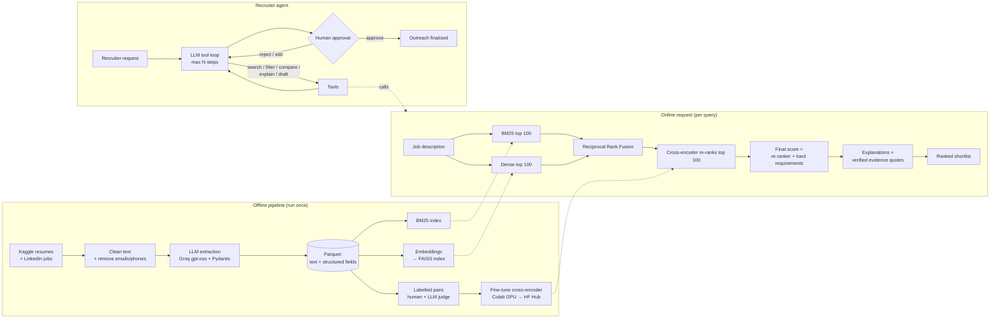

# TalentLens

**Explainable AI job matching with a recruiter agent.**

TalentLens takes a job description and returns a ranked shortlist of candidates. For every candidate it shows *why* they match: which required skills they have and lack, whether their experience fits, and short quotes copied word-for-word from their resume as evidence. A recruiter agent sits on top. You can ask it things like *"find 5 data analysts with SQL and Tableau, compare the top 3, and draft outreach for the best one"*, and it does the searching, filtering and comparing itself. It never sends a message without human approval.

Every number in this README is produced by a script and saved under [`results/`](results/). Nothing is typed in by hand.

> **Project status:** planning complete, implementation in progress. See [PLAN.md](PLAN.md). Sections marked ⏳ fill in as each stage finishes.

---

## Table of contents

1. [The problem](#1-the-problem)
2. [What TalentLens does](#2-what-talentlens-does)
3. [Architecture](#3-architecture)
4. [How it works, step by step](#4-how-it-works-step-by-step)
   - 4.1 [Data and privacy](#41-data-and-privacy)
   - 4.2 [Structured extraction with an LLM](#42-structured-extraction-with-an-llm)
   - 4.3 [Ground truth: human labels and an LLM judge](#43-ground-truth-human-labels-and-an-llm-judge)
   - 4.4 [Stage one: hybrid retrieval](#44-stage-one-hybrid-retrieval)
   - 4.5 [Stage two: cross-encoder re-ranking](#45-stage-two-cross-encoder-re-ranking)
   - 4.6 [Explainable matches](#46-explainable-matches)
   - 4.7 [The recruiter agent](#47-the-recruiter-agent)
   - 4.8 [Fairness check](#48-fairness-check)
5. [How the metrics work](#5-how-the-metrics-work)
6. [Results](#6-results)
7. [API](#7-api)
8. [Running it locally](#8-running-it-locally)
9. [Repository layout](#9-repository-layout)
10. [Limitations](#10-limitations)
11. [Scaling to 10 million candidates](#11-scaling-to-10-million-candidates)
12. [Data licences and ethics](#12-data-licences-and-ethics)
13. [Glossary](#13-glossary)

---

## 1. The problem

Recruiters get hundreds of applications per role. Keyword filters in applicant tracking systems miss good candidates who describe the same skill differently ("Postgres" vs "PostgreSQL", "built REST services" vs "backend development"). Pure AI scoring creates the opposite problem: a single number with no reason behind it, which a recruiter can't trust or check, and which may hide bias.

A useful matching system needs to be:

- **Accurate.** Good candidates show up near the top.
- **Fast.** Results arrive in well under a second, even over a large pool.
- **Explainable.** Every score comes with checkable reasons.
- **Fair.** Changing a candidate's name shouldn't change their rank.
- **Measured.** Each of the above is a number, not a claim.

TalentLens is built around those five requirements.

---

## 2. What TalentLens does

| Feature | What it means for a recruiter | How it's measured |
|---|---|---|
| Structured extraction | Messy resumes and job posts become clean fields: skills, years, seniority, location | Field-level precision / recall / F1 against 100 hand-labelled resumes |
| Two-stage matching | Fast broad search, then a precise re-ranker over the top 100 | Recall@100, nDCG@10, MRR, latency |
| Explanations | Matched/missing skills, experience fit, evidence quotes | % of LLM quotes that fail word-for-word verification |
| Recruiter agent | Natural-language requests become tool calls, with outreach drafts awaiting approval | Task success rate, average steps, average cost on 20 scripted tasks |
| Fairness check | Tests whether names or gender-coded words move rankings | Average rank shift, % of top-10 lists changed, score difference, before/after mitigation |
| Reverse matching | Paste a resume, get the best-fit jobs | Same retrieval metrics, reverse direction |

---

## 3. Architecture



**Tech stack:** Python, pandas, rank_bm25, sentence-transformers, FAISS, BAAI/bge-reranker-base, Groq API (openai/gpt-oss-20b and gpt-oss-120b; Llama 3.3 was retired from Groq), Pydantic, FastAPI, Next.js, pytest, Docker, GitHub Actions, Render (backend), Vercel (frontend), Hugging Face Hub (model hosting), Google Colab (fine-tuning).

---

## 4. How it works, step by step

### 4.1 Data and privacy

**Sources**

- **Kaggle "Resume Dataset":** about 2,400 resumes in 24 job categories, as text and HTML.
- **Kaggle "LinkedIn Job Postings":** a large set of real postings. We keep a working set of about 3,000 whose titles are close to the resume categories, so that most jobs have plausible candidates.

**Cleaning steps and the reason for each**

| Step | Why |
|---|---|
| Strip HTML tags, decode entities (`&` → `&`) | Tags add noise tokens to BM25 and embeddings |
| Fix broken characters (mojibake such as `’` → `'`) | Garbled text breaks skill matching and quote verification |
| Collapse repeated whitespace | Makes lengths comparable and quotes matchable |
| Remove emails and phone numbers (regex) | Resumes are personal data. We don't need contact details to match skills, and they shouldn't reach an external LLM API or GitHub |
| Assign stable IDs from the dataset's own IDs (`R16852973`, `J3884428798`) | Labels, caches and splits must keep pointing to the same document every time the pipeline re-runs. Re-numbering rows (1, 2, 3...) would silently break them if a row were ever dropped |
| Map job titles to the 24 resume categories (ordered keyword rules in `configs/config.yaml`), then sample evenly across categories with a fixed seed | So most jobs have plausible candidates, no single category (e.g. Sales) dominates, and the same 3,000 jobs come back on every run |
| Drop duplicate texts and very short rows | LinkedIn reposts the same ad; a duplicate job could land in both train and test later (leakage) |
| Save as Parquet | Typed, compressed, fast to load, and keeps long text intact (CSV tends to break on embedded newlines and commas) |

**Output:** `data/processed/resumes.parquet`, `data/processed/jobs.parquet`, and `results/data_stats.json` (counts per category, average text length).

### 4.2 Structured extraction with an LLM

Free text is hard to filter. You can't reliably ask "≥ 3 years of experience in Bangalore" of a raw resume. So the LLM turns each document into a fixed schema.

**Resume schema:** `skills`, `total_years_experience`, `job_titles`, `education_level`, `location`, `seniority`
**Job schema:** `title`, `required_skills`, `nice_to_have_skills`, `min_years_experience`, `location`, `seniority`

**Reliability features**

- **Pydantic validation.** Every LLM response is parsed against the schema. Wrong types, missing fields or invalid enum values (for example `seniority: "kinda senior"`) are rejected.
- **Repair loop.** If validation fails, the error message goes back to the LLM ("field X must be an integer") for a limited number of retries. Anything that still fails is logged, not silently dropped.
- **Skill normalisation.** `configs/skill_aliases.yaml` maps variants to one canonical name (`JS` → `JavaScript`, `postgres` → `PostgreSQL`, `ML` → `Machine Learning`). Without this, "JS" and "JavaScript" count as different skills and matching undercounts.
- **Caching.** Each call is stored under a hash of *(model + prompt version + document text)*. Re-running the pipeline costs nothing, and changing the prompt automatically invalidates old answers.
- **Rate limiting with backoff.** Calls respect the API's requests-per-minute and tokens-per-minute limits, and back off on HTTP 429.
- **Cost log.** Every call records input/output tokens and cost in `results/llm_costs.csv`. Prices come from config, not from code.

**How accuracy is measured**

A small CLI shows one resume at a time, and you hand-label the correct fields for 100 resumes. For list fields like `skills`:

- **Precision** = the share of extracted skills that are correct (did the LLM make things up?)
- **Recall** = the share of true skills that were extracted (did the LLM miss things?)
- **F1** = the harmonic mean of the two

Scalar fields (`seniority`, `education_level`) are scored by exact match, and years of experience by "within ±1 year". The output is `results/extraction_eval.csv`.

### 4.3 Ground truth: human labels and an LLM judge

You can't measure ranking quality without knowing which candidates are actually good for a job. So we build labels.

**1. Human labels (200 pairs).** A CLI shows a job and a resume side by side, and you score the pair:

| Label | Meaning |
|---|---|
| 0 | No fit: wrong field or missing most core requirements |
| 1 | Partial fit: right field, some key gaps |
| 2 | Strong fit: meets the core requirements |

We sample 50 jobs × 4 candidates. The candidates are drawn from a **pool** that combines BM25 results, dense results and random resumes. If we sampled only from one method's top results, the labels would favour that method; this "pooling" approach is how the TREC search benchmarks avoid that bias. The mix aims for some obvious pairs, some borderline and some clear misses, because a test made only of easy pairs measures nothing.

**2. LLM judge.** We give an LLM the same rubric and ask it to label the same 200 pairs. Then we measure agreement:

- **Cohen's kappa (κ)** measures agreement beyond what chance alone would produce:
  `κ = (p_observed − p_chance) / (1 − p_chance)`
  κ = 0 means no better than chance, and κ = 1 means perfect agreement. Because our labels are ordered (a 0-vs-2 disagreement is worse than 0-vs-1), we also report **quadratic weighted kappa**, which penalises big disagreements more.
- **Confusion matrix:** a 3×3 table of human label vs judge label, which shows *where* the judge goes wrong (for example, if it is too generous with "2").

**Rule:** the judge labels about 3,000 more pairs **only if** weighted κ reaches a pre-set threshold (0.6, "substantial agreement" on the common Landis & Koch scale). If it doesn't, we change the rubric and measure again. Its labels aren't used until it passes.

**3. Splitting by job.** Jobs are divided into train / validation / test, and **all pairs for a job go into the same split**.

*Why this matters:* if one job appeared in both train and test, the re-ranker could memorise that job's wording and its good candidates during training, then "predict" them at test time. That inflates the scores without the model learning anything general. Splitting by job tests what a real system must do: rank candidates for a **job it has never seen**. This kind of mistake is called *data leakage*.

**Circularity check.** Since the re-ranker is trained on judge labels, testing only on judge labels would partly measure "how well does the model copy the judge?". So test metrics are reported twice: on judge labels (large set) and on **human-labelled test pairs only** (small but trustworthy).

### 4.4 Stage one: hybrid retrieval

The first stage must be **fast** and must **not miss** good candidates (high recall). Precision is the second stage's job.

**BM25 (lexical search).** BM25 scores documents by exact word overlap with the query. It weights rare words higher (IDF) and stops rewarding a word after it has appeared a few times (term-frequency saturation, parameter `k1`). It also adjusts for document length (`b`).
- *Strong at:* exact skills and acronyms ("Kafka", "SAP FICO", "AutoCAD").
- *Weak at:* synonyms and paraphrase ("built server-side APIs" vs "backend engineer").

**Dense embeddings (semantic search).** A bi-encoder (`bge-small-en` or `all-MiniLM-L6-v2`) turns every resume into one vector ahead of time. A query becomes a vector at request time, and FAISS finds the nearest resume vectors by cosine similarity.
- *Strong at:* meaning ("client relationship management" ≈ "account management").
- *Weak at:* rare exact terms, version numbers, and long resumes squeezed into one vector (small models cut off at about 512 tokens).

**Hybrid with Reciprocal Rank Fusion (RRF).** BM25 scores and cosine similarities are on different scales, so adding them directly is meaningless. RRF ignores the raw scores and combines **ranks**:

```
RRF_score(doc) = Σ over methods m of   1 / (k + rank_m(doc))
```

Worked example with `k = 60`:

| Resume | BM25 rank | Dense rank | RRF score |
|---|---|---|---|
| A | 1 | 10 | 1/61 + 1/70 = 0.03068 |
| B | 3 | 3 | 1/63 + 1/63 = 0.03175 |

B wins: being ranked well by *both* methods beats being ranked first by one.

**What `k` does:** it controls how much the very top ranks dominate. With a small `k` (for example 1), rank 1 gets 1/2 and rank 2 gets 1/3, which is a big gap, so one method's top pick wins. With a large `k` (60, the value from the original RRF paper by Cormack et al., 2009), rank 1 and rank 5 score almost the same, so agreement between methods matters more. We report results for a few `k` values on validation, then fix one before touching test.

**Evaluation (`scripts/04b_evaluate.py`).** On the **test split**, for each method: Recall@100, nDCG@10, MRR and average latency in ms. Output: `results/retrieval.csv` and `results/retrieval.md`, plus three real example queries showing where each method wins and fails.

### 4.5 Stage two: cross-encoder re-ranking

**Bi-encoder vs cross-encoder**

| | Bi-encoder (stage one) | Cross-encoder (stage two) |
|---|---|---|
| Input | Job and resume encoded **separately** | Job and resume fed **together** as one input |
| Speed | Resume vectors computed once, search takes milliseconds | One model run per (job, resume) pair, slow |
| Accuracy | Lower: the two texts never "see" each other | Higher: attention compares every job word with every resume word |
| Used for | Searching the whole pool | Re-ordering only the top 100 |

This is the core idea of two-stage matching: use the cheap model to shrink millions of candidates to 100, then spend expensive compute only on those 100.

**Baseline:** off-the-shelf `BAAI/bge-reranker-base`, scored with the same metrics.

**Fine-tuning** (`notebooks/finetune_reranker.ipynb`, free Colab GPU):

- **Training data:** TRAIN-split pairs with graded labels 0/1/2.
- **Loss:** binary cross-entropy with soft targets (0 → 0.0, 1 → 0.5, 2 → 1.0). It is simple, stable, supported directly by sentence-transformers' `CrossEncoder`, and keeps the "partial fit" information instead of reducing everything to yes/no. A listwise loss (for example LambdaLoss) would optimise ranking more directly; it is listed as a future experiment so its gain can be measured separately.
- **Hard negatives:** for each training job, take resumes that hybrid retrieval ranks highly but that are labelled 0. These look relevant but aren't, and they teach the model the fine distinctions. Random negatives are too easy to teach much.
- **Learning rate:** small (around 2e-5) with warm-up, because we are adjusting a pre-trained model, not training from scratch. A large rate erases what it already knows.
- **Epochs and early stopping:** a few epochs at most. After each epoch we compute nDCG@10 on VALIDATION and keep the best checkpoint. Training stops when validation stops improving.
- **Avoiding overfitting:** job-level splits (no leakage), early stopping on validation, a small learning rate, and the test split touched exactly **once**, at the end.
- **Model hosting:** pushed to Hugging Face Hub, so the API loads it by name.

**Ablation (the main result table):** BM25 → dense → hybrid → hybrid + base re-ranker → hybrid + fine-tuned re-ranker, with nDCG@10, MRR and latency for each. Output: `results/ablation.csv`.

### 4.6 Explainable matches

For each (job, candidate) pair, TalentLens produces:

- **Required skills:** matched ✅ / missing ❌ (computed from normalised skill sets, not by the LLM)
- **Nice-to-have skills:** matched
- **Experience fit:** "has 4 years, needs 3+"
- **Seniority and location fit**
- **Two or three evidence quotes:** short passages from the resume supporting the match

**Quote verification (no hallucinated evidence).** The LLM is asked to copy quotes exactly. Each quote is then checked in code: after normalising whitespace and quote characters, the quote must appear **as an exact substring** of the cleaned resume text. Any quote that doesn't is **dropped**, never shown. We count and report how often this happens (`results/explanations.json` → quote failure rate), because that rate shows how far the LLM can be trusted with evidence.

**Final match score.** The re-ranker captures overall relevance but doesn't know that a job *requires* a degree or five years of experience. The final score blends both:

```
final = w1 · reranker_score_normalised
      + w2 · required_skill_coverage        (matched required / total required)
      + w3 · experience_fit                 (1 if years ≥ minimum, otherwise years / minimum)
```

The weights `w1, w2, w3` sum to 1 and are tuned on **validation** nDCG@10, never on test. Each component sits between 0 and 1, so every part of the score can be shown and explained to the recruiter. Location is shown as a flag rather than added to the score, because whether location is a hard requirement differs by job.

### 4.7 The recruiter agent

The agent is a hand-written loop with no LangChain or similar framework, so every step is visible and testable.

**Tools**

| Tool | What it does |
|---|---|
| `search_candidates(job_text or query)` | Runs the full two-stage matcher |
| `filter_candidates(location, min_years, skills)` | Filters by structured fields |
| `compare_candidates(ids)` | Side-by-side table of skills, experience, scores |
| `explain_match(job_id, candidate_id)` | The section 4.6 explanation |
| `draft_outreach(candidate_id, job_id)` | Writes a personalised message, saved as **PENDING_APPROVAL** |

**The loop**

```mermaid
sequenceDiagram
    participant R as Recruiter
    participant A as Agent loop
    participant L as LLM (gpt-oss-120b)
    participant T as Tools
    R->>A: "Find 5 X with Y, compare top 3, draft outreach for best"
    loop until final answer or max steps
        A->>L: conversation + tool definitions
        L-->>A: tool call (name + JSON args) OR final answer
        A->>A: validate args (Pydantic); log the call
        A->>T: run tool
        T-->>A: result, or error message
        A->>L: tool result appended to conversation
    end
    A-->>R: answer + full step log + drafts PENDING_APPROVAL
    R->>A: Approve / Reject
```

**Safety and reliability**

- **Step limit:** the loop stops after N steps (for example 8) and reports what it has, so it can't loop forever or run up costs.
- **Tool-error handling:** bad arguments or tool failures go back to the LLM as an error message so it can correct itself. They never crash the loop.
- **Full log:** every step records the tool name, arguments, result summary, tokens and latency, so any run can be replayed and debugged.
- **Human approval:** `draft_outreach` can only create drafts. Only a human action through the API or the UI "Approve" button changes a draft to `APPROVED`. The agent has no tool that sends anything.

**Evaluation:** 20 scripted tasks, each with a checkable expected outcome (for example "result contains ≥ 3 candidates, all in Chicago, all with SQL"; "called `compare_candidates` with exactly 3 IDs"; "outreach left pending, not approved"). We report **task success rate, average steps and average cost** in `results/agent_eval.csv`. Some tasks are deliberately impossible (no matching candidates) to test that the agent says so instead of inventing results.

### 4.8 Fairness check

**Question:** does changing *only* who the candidate appears to be change where they rank?

**Method (counterfactual testing):**

1. Take 200 test resumes.
2. Create variants that change only the name (names associated with different genders and regions) and gender-coded words (he/she, "chairman/chairwoman"). Skills, experience and education stay identical.
3. Run every variant through the full pipeline against the same jobs.

**Measurements**

- **Average absolute rank shift** of the same resume across its variants
- **% of top-10 lists that change** when variants are swapped in
- **Average score difference** between variants

**Mitigation:** if the numbers show a real shift, we add a step that **redacts names and personal identifiers before scoring**, then measure again. The before/after numbers go in `results/fairness_report.md`.

**What this test does *not* show** (this goes in the report too):
- It only tests the attributes we swapped. It says nothing about bias carried by proxies such as college names, gaps in employment, or hobbies.
- Names are an imperfect stand-in for gender or region.
- A small shift on 200 resumes doesn't prove the system is fair. It only means no bias was detected *by this test*.
- Bias can also come from the training labels (human or LLM judge), which this test doesn't measure.

---

## 5. How the metrics work

Worked examples, so each number in the results is easy to interpret.

**Recall@100.** Of all relevant resumes for a job, what share appear in the top 100? For example, 8 relevant resumes and 6 in the top 100 gives Recall@100 = 0.75. This matters for stage one: anything missed here can't be recovered by the re-ranker.

**MRR (Mean Reciprocal Rank).** For each job, find the rank of the **first** relevant resume and take 1/rank. Then average over jobs. First relevant at rank 1 → 1.0, at rank 2 → 0.5, at rank 4 → 0.25. MRR measures how quickly a recruiter sees a good candidate.

**nDCG@10 (normalised Discounted Cumulative Gain).** This uses the **graded** labels (0/1/2) and rewards putting the *best* candidates *highest*.
- Gain of a result = 2^label − 1 (so 0 → 0, 1 → 1, 2 → 3)
- Discount at rank i = 1 / log2(i + 1)
- Example top 3 labels: `[2, 0, 1]`
  - DCG = 3/1 + 0/1.585 + 1/2 = **3.5**
  - Ideal order `[2, 1, 0]`: IDCG = 3/1 + 1/1.585 + 0 = **3.631**
  - nDCG = 3.5 / 3.631 = **0.964**

**"Relevant"** means label ≥ 1 for Recall and MRR (configurable). Resumes nobody labelled count as non-relevant. That is standard, but it slightly *underestimates* all methods (see [Limitations](#10-limitations)).

**Latency** is wall-clock milliseconds per query, averaged over the test jobs on the same machine, with the model already loaded.

---

## 6. Results

> ⏳ Every table below is filled in automatically from `results/` once the stage that produces it finishes. Empty cells mean "not run yet", not zero.

### 6.1 Dataset (Stage 1) — `results/data_stats.json`
| | Resumes | Jobs |
|---|---|---|
| Raw rows | 2,484 | 123,849 |
| Final working set | 2,481 | 3,000 (from 45,738 eligible after title matching + cleaning) |
| Categories | 24 | 24 |
| Mean / median length (chars) | 5,926 / 5,542 | 3,701 / 3,367 |
| Duplicates removed | 2 | 6,945 |
| Emails / phones / URLs removed | 36 / 155 / 201 | 7,885 / 3,999 / 12,152 (before sampling) |
| Contact details left after redaction | 0 | 0 |

Smallest categories: BPO (22 resumes), Automobile (36), Agriculture (63 resumes, 76 jobs) and Fitness (82 jobs). Results for these are less reliable.

### 6.2 Extraction accuracy (Stage 2) — `results/extraction_eval.csv`
| Field | Precision | Recall | F1 |
|---|---|---|---|
| skills | – | – | – |
| job_titles | – | – | – |
| total_years_experience (±1y) | – | – | – |
| education_level | – | – | – |
| seniority | – | – | – |
| location | – | – | – |

Total LLM cost and tokens: `results/llm_costs.csv`

### 6.3 LLM judge agreement (Stage 3) — `results/judge_agreement.json`
| Cohen's κ | Weighted κ | Used for extra labels? |
|---|---|---|
| – | – | – |

### 6.4 Ablation (Stages 4–5) — `results/ablation.csv`
| Method | Recall@100 | nDCG@10 | MRR | Latency (ms) |
|---|---|---|---|---|
| BM25 | – | – | – | – |
| Dense (bge-small) | – | – | – | – |
| Hybrid (RRF) | – | – | – | – |
| Hybrid + bge-reranker-base | – | – | – | – |
| Hybrid + fine-tuned reranker | – | – | – | – |

Reported on judge labels and separately on human-labelled test pairs.

### 6.5 Explanations (Stage 6) — `results/explanations.json`
| Quotes generated | Failed verification | Failure rate |
|---|---|---|
| – | – | – |

### 6.6 Agent (Stage 7) — `results/agent_eval.csv`
| Tasks | Success rate | Avg. steps | Avg. cost |
|---|---|---|---|
| 20 | – | – | – |

### 6.7 Fairness (Stage 8) — `results/fairness_report.md`
| | Avg. rank shift | % top-10 changed | Avg. score diff |
|---|---|---|---|
| Before mitigation | – | – | – |
| After mitigation | – | – | – |

### 6.8 Screenshots
⏳ Added after Stage 9.

---

## 7. API

FastAPI. Interactive docs are served at `/docs` once the server is running. All models load **once at startup**, and repeated identical queries are served from cache.

| Method | Endpoint | Input | Output |
|---|---|---|---|
| `POST` | `/match/job` | `{ "job_text": "...", "top_k": 10 }` | Ranked candidates, each with score, score breakdown, matched/missing skills, verified quotes |
| `POST` | `/match/resume` | `{ "resume_text": "...", "top_k": 10 }` | Best-fit jobs (reverse direction) |
| `POST` | `/agent` | `{ "request": "Find 5 ..." }` | Agent step log, final answer, outreach drafts with status `PENDING_APPROVAL` |
| `POST` | `/agent/outreach/{id}/approve` | – | Marks a draft `APPROVED` (human action only) |
| `GET` | `/health` | – | Status, model versions loaded, index sizes |

Errors return a clear JSON body (`{"error": "...", "detail": "..."}`) with the right HTTP code: 422 for invalid input, 503 if a model isn't loaded, 502 if the LLM provider fails.

---

## 8. Running it locally

> ⏳ These commands become valid as each stage is built.

```bash
# 1. Install
python -m venv .venv && source .venv/bin/activate      # Windows: .venv\Scripts\activate
pip install -e ".[dev]"
cp .env.example .env                                    # add GROQ_API_KEY, HF_TOKEN

# 2. Put the Kaggle downloads in data/raw/, then run the pipeline in order
python scripts/01_prepare_data.py
python scripts/02_extract.py
python scripts/04_build_indexes.py
python scripts/04b_evaluate.py

# 3. Run tests
pytest

# 4. Start the backend and frontend
uvicorn talentlens.api.main:app --reload               # http://localhost:8000/docs
cd frontend && npm install && npm run dev              # http://localhost:3000

# Or with Docker
docker build -t talentlens . && docker run -p 8000:8000 --env-file .env talentlens
```

**CI:** GitHub Actions runs `pytest` on every push. **Deployment:** backend on Render, frontend on Vercel. CORS origins and secrets come from environment variables only.

---

## 9. Repository layout

See [PLAN.md § Repo structure](PLAN.md#1-repo-structure) for the annotated tree. In short:

- `src/talentlens/` — all logic, one package
- `scripts/` — numbered entry points, run in order
- `notebooks/` — Colab fine-tuning
- `results/` — every reported number (committed)
- `data/` — raw and processed data (**not** committed: personal data)
- `tests/`, `frontend/`, `Dockerfile`, `.github/workflows/`

---

## 10. Limitations

- **Dataset fit:** the resume set covers 24 broad categories (HR, chef, aviation, IT, finance ...) with about 100 resumes each, mostly US-style. It isn't a tech-hiring dataset, so niche queries ("Kafka engineers in Bangalore") may return few or no real matches.
- **Small pool:** with about 2.4k resumes, Recall@100 is easier to achieve than it would be over millions of resumes.
- **Incomplete labels:** only labelled pairs count as relevant, so all methods are somewhat underestimated, and a method that finds good but *unlabelled* resumes isn't rewarded.
- **Judge labels:** the LLM judge is validated against one human labeller (you). One person's view of "fit" isn't the industry's view.
- **Extraction errors carry forward:** a skill missed in Stage 2 shows up as "missing" in the explanation.
- **Fairness scope:** see the limits in section 4.8.
- **English only.**

**Future work:** listwise loss (LambdaLoss) for the re-ranker; a distilled re-ranker for lower latency; using structured filters during retrieval; multiple human labellers with inter-annotator agreement; a bias audit on proxy attributes; feedback from recruiter clicks as training signal.

---

## 11. Scaling to 10 million candidates

The current design (flat FAISS index, in-memory BM25) is right for about 2.4k resumes. At 10M with a sub-second target:

| Component | Now | At 10M |
|---|---|---|
| Dense index | FAISS flat (exact) | Approximate nearest neighbour: HNSW or IVF-PQ (compressed vectors), sharded |
| Lexical index | rank_bm25 in memory | Elasticsearch / OpenSearch (inverted index, sharded) |
| Filters | Applied after retrieval | Pre-filter by location, years and skills inside the search engine |
| Embeddings | Computed in a script | Batch jobs offline + incremental updates for new resumes |
| Re-ranker | bge-reranker-base on top 100 | Distilled/smaller cross-encoder, top 50, GPU batching, cached per (job, resume) |
| Explanations | Computed per request | Computed lazily, only for results the recruiter opens |

The key point is that the expensive cross-encoder cost depends on the **top-k**, not on the pool size. Only the first stage has to grow to 10M, and approximate search is built for that.

---

## 12. Data licences and ethics

- Check the licence of each Kaggle dataset on its page **before** publishing anything derived from it.
- Raw and cleaned resume text is **never committed**. The repo contains code, aggregate statistics and a few short anonymised examples.
- Emails and phone numbers are removed in Stage 1, before any text is sent to an external LLM API.
- The agent can't contact anyone. Every outreach requires human approval.
- TalentLens is a decision-*support* tool. Explanations and the fairness report exist so a human can check every ranking.

---

## 13. Glossary

| Term | Meaning |
|---|---|
| **BM25** | Classic keyword ranking function that weights rare terms and limits repetition |
| **Embedding** | A vector representing a text's meaning; similar texts get nearby vectors |
| **Bi-encoder** | Encodes query and document separately, so it's fast and searchable at scale |
| **Cross-encoder** | Reads query and document together, so it's accurate but slow; used to re-rank |
| **FAISS** | Library for fast vector similarity search |
| **RRF** | Reciprocal Rank Fusion: combines rankings via Σ 1/(k + rank) |
| **Hard negative** | A non-matching example that looks like a match; teaches fine distinctions |
| **Data leakage** | Test information reaching training, which inflates scores |
| **Cohen's κ** | Agreement between two labellers, corrected for chance |
| **nDCG@10** | Ranking quality in the top 10 with graded relevance |
| **MRR** | Average of 1/rank of the first relevant result |
| **Recall@100** | Share of relevant items found in the top 100 |
| **Counterfactual test** | Change one attribute, keep everything else equal, observe the output |
| **Pydantic** | Python library that validates data against a typed schema |
